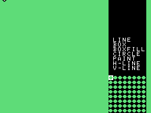
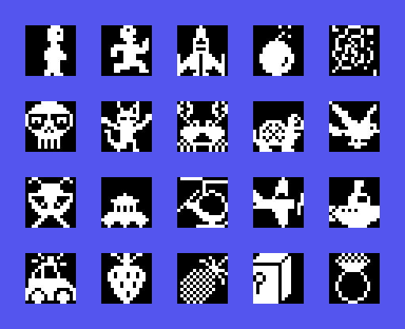
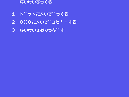

# The editors

## The background, drawn

With one background, the editor is a 176 x 192 dot canvas in SCREEN 2 with the tools on the right: **LINE, BOX,
BOXFILL, CIRCLE, PAINT, H-LINE and V-LINE** (0x5131). Each one is a routine in the ROM (the table at 0x5813) and they
all paint straight into VRAM, dot by dot, in the border colour (0xFA38): a line with Bresenham's algorithm
(`linea_bresenham`, 0xAA38), the circle by octants from the square root of the radius (`circulo`, 0xAFC8) and PAINT
filling span by span with a stack in free memory (`pintar`, 0xAB2A).

This house was drawn in openMSX by a script taken from the listing (`tools/guiones/juego.tcl`): the sky with PAINT,
the ground with BOXFILL, the sun with CIRCLE and PAINT, the house with BOXFILL, the roof with LINE and PAINT, door,
windows and a tree.

With three backgrounds or the scrolling one, the background is made of **tiles**: a palette of 8 x 8 tiles on the
right (`paleta_casillas`, 0x5CE0), each one drawn enlarged and placed on a 22 x 24 map (`mapa_posicion`, 0x5A9D). The
scrolling one grows by rows: one key inserts a row and another removes it, moving everything in memory (`fila_mete`,
0x5B0E).

## The characters

A character is 16 x 16, 32 x 16, 16 x 32 or 32 x 32 dots (one, two or four sprites) and can have **eight drawings**,
one per direction, so that it changes with where it is going. It is drawn dot by dot on an enlarged grid, flipped,
shifted, copied from another one or taken from the **20 samples** in the ROM (0xA541):

The recording makes two: **HERO**, the hero, with the running man, and **KANI**, with the crab.

Sprites are scarce -32 on the whole MSX- and Game Land shares them out: a table (0xFBFE) records which drawing of which
character takes each one; a new drawing gets room found for it and the others are moved (`dibujo_sitio`, 0x62C1), and
if it does not fit, "not enough memory".

## The sounds

Named sounds (0xF423, 13 bytes each; registering allows 19 and the list shows 18). A **melody** is written on a staff of 32 notes over four pages
(`pentagrama`, 0x9B58): space cycles note, rest and bar line, up and down change the pitch; it has **TEMPO** (ten
speeds), **REPEAT** and **CHORD** (two more notes below on the other channels). It can also start from the four
sample tunes. An **effect** is picked from five kinds (movement, mechanical, explosion, science fiction and alarm)
with five each: the 13 PSG registers at once, with their envelope.

## The story and the movements

The story has up to **eight stages**. In each one the characters are placed with their role -the hero, his weapon,
the enemies and their weapons- and, for each, where it appears (an area marked with two crosses), how many times and
how often, its points, its speed and its step, what it does at the edge (stop, come out the other side or vanish),
its sounds and the drawing it leaves when it falls. And **how it moves**, from a list of 31 movements (the table at
0xB1A4):

| who | how |
|---|---|
| the hero | with the joystick: only up and down, only sideways, in four directions or in eight |
| the enemies | along a route of up to 31 points, in one of the eight directions, at random, fixed up, down, left or right, closing in on the hero or moving away |
| in the maze | at random (turning at crossings), closing in, moving away or standing still |
| the hero's weapon | to a target, fixed in one direction, where the hero is facing or standing still |
| the enemy weapon | fixed, at the hero, closing in on him or standing still |

The route is drawn point by point on the screen, and the speed is tried out by watching the character run
(`muestra_mueve`, 0x7BC4).

The recording on this site goes as far as the characters: the story and a game were not recorded. This part comes
from the listing.
