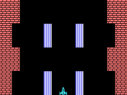
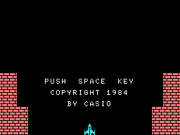

# The program

**Game Land** (ゲームランド; Casio, 1984) is a cartridge for **making games** on the MSX without writing a line of
code: two kinds of game, one, three or a scrolling background, characters, sounds, a story of up to eight stages and
an engine that plays it all. What you make is saved to tape.

Everything is in Japanese, with the BIOS kana font: that is why the recordings are made on a **Casio PV-16**, Casio's
MSX, and not on a European one (which draws other letters for those codes).

## The intro

A ship (the rocket from the character samples) goes up a road between brick walls, with its tune, until the space
bar is pressed. The whole road is built in RAM (0xE000, three screens high) and the interrupt hook copies it to the
screen one row further up on every frame (`presentacion_cuadro`, 0x9747).

## The menus

Everything is done through menus: up and down move the arrow and **RETURN** chooses. Each menu has its title and its
options (0xB5D3), made of texts (0xB806) that in turn pull in pieces that repeat (0xB4E0: ゲーム, をつくる,
スクロール...); the routine of each option is in the table at 0xB304. The program keeps a stack with the menus it has
gone through (0xF8A8), and F5 goes back to the previous one.

The main ones, as they appear in the ROM:

| menu | in the ROM | translated |
|---|---|---|
| 0x01 | ゲームランドでなにをしますか | What shall we do in Game Land? |
| | ゲームであそぶ / ゲームをつくる / ゲームをなおす / ゲームをよみこむ / ゲームをほぞんする | play / make a game / fix it / load it from tape / save it |
| 0x04 | ゲームのしゅるいはどれにしますか | What kind of game? |
| | せんとうしきゲーム / めいろしきゲーム | a shooting game / a maze game |
| 0x05 | はいけいはどれにしますか | Which background? |
| | 1しゅるい / 3しゅるい / スクロールする | one / three / scrolling |
| 0x07 | スクロールはどれにしますか | How does it scroll? |
| | じぶんのうごきでスクロールする / じどうてきにスクロールする (x2) | with the hero / by itself (one way or the other) |
| 0x0C | なにをしますか | What shall we do? |
| | はいけいをつくる / キャラクタをつくる / おとをつくる / ストーリーをきめる / おわり | the background / the characters / the sounds / the story / finish |
| 0x1B | はいけいをつくる | Make the background |
| | ドットたんいでつくる / 8X8たんいでコピーする / はいけいをぬりつぶす | dot by dot / copy 8 by 8 / fill it |
| 0x7B | なにをしますか | (the characters) |
| | あたらしくつくる / なおす / コピーする / けす / おわり | new / fix / copy / delete / finish |
| 0x85 | つぎのどれをつくりますか | Which one shall we make? |
| | じぶん / そのた | the hero / another |
| 0x83 | おおきさをきめてください(ヨコXタテ) | The size (width x height) |
| | 16X16 / 32X16 / 16X32 / 32X32 | one, two or four sprites |
| 0x82 | むきによってかたちをかえますか | Does it change drawing with its direction? |
| 0x22 | キャラクタをつくる | Make the character |
| | ドットたんいでつくる / サンプル / さゆうをはんてんする / じょうげをはんてんする / パターンをずらす / けす / コピーする | dot by dot / samples / flip sideways / flip upside down / shift / delete / copy |
| 0x2B | なにをしますか | (the stage of the story) |
| | キャラクタのうごきかたをきめる / タイマーをきめる / ゲームちゅうのおとをきめる / おわり | how they move / the timer / the sounds in play / finish |
| 0x47 | どのキャラクタについてきめますか | Whom are we deciding about? |
| | じぶん / じぶんのぶき / あいて / あいてのぶき / おわり | the hero / his weapon / the enemy / its weapon / finish |
| 0x87 | なにをしますか | (the sounds) |
| | あたらしくおとをつくる / おとをなおす / おとをけす / おわり | new sound / fix / delete / finish |
| 0x8A | どんなおとをつくりますか | What sound? |
| | メロディ / こうかおん | a melody / an effect |
| 0x8C | なにをしますか | (the staff) |
| | ふめん / おとをきく / テンポ / リピート / コード / おわり | the score / listen / tempo / repeat / chords / finish |

And some of the messages (0xB755):

| in the ROM | translated |
|---|---|
| メモリーがたりません / スペースキーをおしてください | Not enough memory / press the space bar |
| ゲームがあります / けさないならば おわりキーを / けしてもよければ / スペースキーをおしてください | There is a game already / if you don't want to delete it, the finish key; if it can go, the space bar |
| このキャラクタはすでにつかわれています | This character is already in use |
| うまくよみこめません | It could not be loaded |
| ほぞんがうまくできていません | It was not saved properly |
| もうとうろくできません | No more can be registered |
| スペースキーと矢印キーでかきます / シフトキーと矢印キーで+をはやくうごかします / リターンキーでメニューにもどります | Space and the arrows draw / SHIFT and the arrows move the cross fast / RETURN goes back to the menu |

## The keys

What each key does comes from the keyboard tables (0x4474 in the menus, 0x44C6 when typing names) and the lists of
each editor mode (0x52B9):

| key | what it does |
|---|---|
| arrows | move; with SHIFT, 8 dots at a time |
| space | do (draw, place, pick the sample) |
| RETURN | choose in a menu; in an editor, back to the menu |
| 1 to 8 | when drawing: no tool, LINE, BOX, BOXFILL, CIRCLE, PAINT, H-LINE and V-LINE |
| letters | the colours: Q black, E green, W light green, U blue, Y light blue, D dark red, T cyan, S red, A light red, G dark yellow, F light yellow, R dark green, H magenta, J grey and K white |
| F2 / F3 / F4 | the list of sounds / of characters / the menu help |
| F5 | the previous menu |
| 9 / 0 | in the scrolling background, insert or remove a row (codes 0x0B and 0x0C; the help calls them INS and DEL) |
| STOP | drops whatever is going on and goes back to the start |

## The kinds of game

What is chosen in menus 4 and 5 ends up in one byte (0xF421): 0x10 for a **shooting game** or 0x40 for a **maze
game**, plus 0x01 with **one background** (drawn dot by dot, 0x11), 0x08 with **three backgrounds** made of tiles or
0x02 with **one that scrolls** (as long as the memory allows, row by row). In the maze the background is made of wall
tiles, path tiles and 10, 20 and 30 point tiles, and the stage ends when there are no point tiles left.
