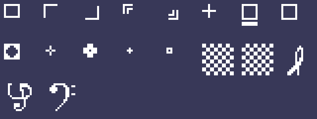

# The sprites

*Game Land* is a program for making games: the characters are drawn by whoever uses it, with the editors (see
[The editors](THE-EDITORS.html)). The only sprite drawings the ROM brings are the program's own, and
`vram_prepara` (0x40D2) puts them in the sprite drawing table (0x1800, register 6 = 3). Here `tools/hojas.py`
**runs that routine** with the Z80 of `tools/bios.py` (the tape calls, TAPOOF and STMOTR, and RDVDP draw nothing and
are skipped) and paints the 16 × 16 drawings it leaves (register 1, 0xE2). None of these images is a screenshot.

**Checked against openMSX** on the recordings of this site: the drawings from 0x90 to the end of the table that the
routine leaves here are **identical** to the game's on 27,043 frames; on 232 more drawings 0xD0-0xDC hold the
character being edited, which the sample window of the editor writes there (`personaje_muestra`, 0x61BA); **0
different**.

## The program's own sprites

Eighteen drawings, 0x90 to 0xE8: boxes, corners and crosses of several sizes for the editors' cursors, a checked
pattern (twice) and three music signs, among them the treble and bass clefs of the music editor:

The characters a user draws go from 0x1800 onwards: each one, one, two or four 16 × 16 sprites in a square
(`objeto_dibuja`, 0x49AB: +0, +0x10, +0x1000 and +0x1010), with their colours four by four.
