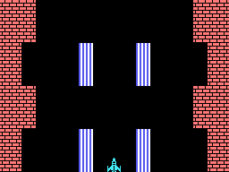
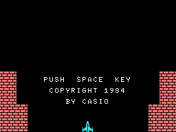

# El programa

**Game Land** (ゲームランド; Casio, 1984) es un cartucho para **hacer juegos** en el MSX sin escribir una
l&iacute;nea de programa: dos clases de juego, uno, tres fondos o uno que se desplaza, personajes, sonidos, una
historia de hasta ocho fases y un motor que lo juega todo. Lo hecho se guarda en cinta.

Todo est&aacute; en japon&eacute;s, con la fuente de kana de la BIOS: por eso las grabaciones son en un **Casio
PV-16**, el MSX de Casio, y no en uno europeo (que pinta otras letras en esos c&oacute;digos).

## La presentaci&oacute;n

Una nave (el cohete de las muestras de personajes) sube por una carretera entre muros de ladrillo, con su
m&uacute;sica, hasta que se pulsa la barra. La carretera se arma entera en la RAM (0xE000, tres pantallas de alto) y
el gancho de la interrupci&oacute;n la copia a la pantalla una fila m&aacute;s arriba en cada cuadro
(`presentacion_cuadro`, 0x9747).

## Los men&uacute;s

Todo se hace con men&uacute;s: arriba y abajo mueven la flecha y **RETURN** elige. Cada men&uacute;
tiene su t&iacute;tulo y sus opciones (0xB5D3), hechos de textos (0xB806) que a su vez meten trozos que se repiten
(0xB4E0: ゲーム, をつくる, スクロール...); la rutina de cada opci&oacute;n est&aacute; en la tabla de 0xB304. El
programa lleva una pila con los men&uacute;s por los que se ha pasado (0xF8A8), y F5 vuelve al de antes.

Los principales, tal como salen en la ROM:

| men&uacute; | en la ROM | traducido |
|---|---|---|
| 0x01 | ゲームランドでなにをしますか | &iquest;Qu&eacute; hacemos en Game Land? |
| | ゲームであそぶ / ゲームをつくる / ゲームをなおす / ゲームをよみこむ / ゲームをほぞんする | jugar / hacer un juego / arreglarlo / cargarlo de la cinta / guardarlo |
| 0x04 | ゲームのしゅるいはどれにしますか | &iquest;Qu&eacute; clase de juego? |
| | せんとうしきゲーム / めいろしきゲーム | de combate / de laberinto |
| 0x05 | はいけいはどれにしますか | &iquest;Qu&eacute; fondo? |
| | 1しゅるい / 3しゅるい / スクロールする | uno / tres / que se desplace |
| 0x07 | スクロールはどれにしますか | &iquest;C&oacute;mo se desplaza? |
| | じぶんのうごきでスクロールする / じどうてきにスクロールする (x2) | con el protagonista / solo (en un sentido o en el otro) |
| 0x0C | なにをしますか | &iquest;Qu&eacute; se hace? |
| | はいけいをつくる / キャラクタをつくる / おとをつくる / ストーリーをきめる / おわり | el fondo / los personajes / los sonidos / la historia / acabar |
| 0x1B | はいけいをつくる | Hacer el fondo |
| | ドットたんいでつくる / 8X8たんいでコピーする / はいけいをぬりつぶす | punto a punto / copiar de 8 en 8 / rellenarlo |
| 0x7B | なにをしますか | (los personajes) |
| | あたらしくつくる / なおす / コピーする / けす / おわり | nuevo / arreglar / copiar / borrar / acabar |
| 0x85 | つぎのどれをつくりますか | &iquest;Cu&aacute;l se hace? |
| | じぶん / そのた | el protagonista / otro |
| 0x83 | おおきさをきめてください(ヨコXタテ) | El tama&ntilde;o (ancho x alto) |
| | 16X16 / 32X16 / 16X32 / 32X32 | uno, dos o cuatro sprites |
| 0x82 | むきによってかたちをかえますか | &iquest;Cambia de dibujo seg&uacute;n hacia d&oacute;nde va? |
| 0x22 | キャラクタをつくる | Hacer el personaje |
| | ドットたんいでつくる / サンプル / さゆうをはんてんする / じょうげをはんてんする / パターンをずらす / けす / コピーする | punto a punto / muestras / voltear de lado / voltear de arriba abajo / desplazar / borrar / copiar |
| 0x2B | なにをしますか | (la fase de la historia) |
| | キャラクタのうごきかたをきめる / タイマーをきめる / ゲームちゅうのおとをきめる / おわり | c&oacute;mo se mueven / el tiempo / los sonidos de la partida / acabar |
| 0x47 | どのキャラクタについてきめますか | &iquest;De qui&eacute;n se decide? |
| | じぶん / じぶんのぶき / あいて / あいてのぶき / おわり | el protagonista / su arma / el enemigo / su arma / acabar |
| 0x87 | なにをしますか | (los sonidos) |
| | あたらしくおとをつくる / おとをなおす / おとをけす / おわり | sonido nuevo / arreglar / borrar / acabar |
| 0x8A | どんなおとをつくりますか | &iquest;Qu&eacute; sonido? |
| | メロディ / こうかおん | una melod&iacute;a / un efecto |
| 0x8C | なにをしますか | (el pentagrama) |
| | ふめん / おとをきく / テンポ / リピート / コード / おわり | la partitura / escucharla / el tempo / repetir / acordes / acabar |

Y algunos avisos (0xB755):

| en la ROM | traducido |
|---|---|
| メモリーがたりません / スペースキーをおしてください | No hay memoria bastante / pulsa la barra |
| ゲームがあります / けさないならば おわりキーを / けしてもよければ / スペースキーをおしてください | Ya hay un juego / si no quieres borrarlo, la tecla de acabar; si se puede borrar, la barra |
| このキャラクタはすでにつかわれています | Este personaje ya se usa |
| うまくよみこめません | No se ha podido cargar |
| ほぞんがうまくできていません | No se ha guardado bien |
| もうとうろくできません | Ya no se pueden registrar m&aacute;s |
| スペースキーと矢印キーでかきます / シフトキーと矢印キーで+をはやくうごかします / リターンキーでメニューにもどります | La barra y las flechas dibujan / SHIFT y las flechas mueven la cruz deprisa / RETURN vuelve al men&uacute; |

## Las teclas

Lo que hace cada tecla sale de las tablas del teclado (0x4474 en los men&uacute;s, 0x44C6 al escribir nombres) y de
las listas de cada modo de los editores (0x52B9):

| tecla | qu&eacute; hace |
|---|---|
| flechas | mover; con SHIFT, de 8 en 8 puntos |
| barra | hacer (dibujar, poner, elegir la muestra) |
| RETURN | elegir en un men&uacute;; en un editor, volver al men&uacute; |
| 1 a 8 | en el dibujo: sin herramienta, LINE, BOX, BOXFILL, CIRCLE, PAINT, H-LINE y V-LINE |
| letras | los colores: Q negro, E verde, W verde claro, U azul, Y azul claro, D rojo oscuro, T cian, S rojo, A rojo claro, G amarillo oscuro, F amarillo claro, R verde oscuro, H magenta, J gris y K blanco |
| F2 / F3 / F4 | la lista de sonidos / la de personajes / la ayuda del men&uacute; |
| F5 | el men&uacute; de antes |
| 9 / 0 | en el fondo que se desplaza, meter o quitar una fila (los c&oacute;digos 0x0B y 0x0C; la ayuda los llama INS y DEL) |
| STOP | deja lo que se est&eacute; haciendo y vuelve al principio |

## Las clases de juego

Lo elegido en los men&uacute;s 4 y 5 queda en un byte (0xF421): 0x10 si es **de combate** o 0x40 si es **de
laberinto**, m&aacute;s 0x01 con **un fondo** (dibujado punto a punto, 0x11), 0x08 con **tres fondos** de casillas o
0x02 con **uno que se desplaza** (de hasta lo que quepa en la memoria, fila a fila). En el laberinto el fondo se hace
con casillas de pared, de camino y de 10, 20 y 30 puntos, y el juego se acaba cuando no queda ninguna de puntos.
