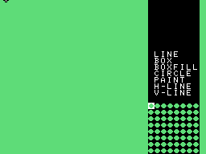
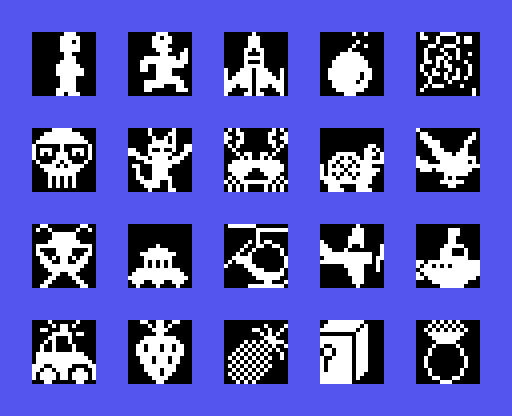
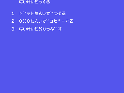

# Los editores

## El fondo, dibujado

Con un fondo, el editor es un lienzo de 176 x 192 puntos en SCREEN 2 con las herramientas a la derecha: **LINE, BOX,
BOXFILL, CIRCLE, PAINT, H-LINE y V-LINE** (0x5131). Cada una es una rutina de la ROM (la tabla de 0x5813) y todas
pintan en la VRAM directamente, punto a punto, con el color del borde (0xFA38): una l&iacute;nea con el algoritmo de
Bresenham (`linea_bresenham`, 0xAA38), el c&iacute;rculo por octantes desde la ra&iacute;z cuadrada del radio
(`circulo`, 0xAFC8) y PAINT rellenando por tramos con una pila en la memoria libre (`pintar`, 0xAB2A).

Esta casa la dibuj&oacute; en openMSX un guion sacado del listado (`tools/guiones/juego.tcl`): el cielo con PAINT, el
suelo con BOXFILL, el sol con CIRCLE y PAINT, la casa con BOXFILL, el tejado con LINE y PAINT, puerta, ventanas y un
&aacute;rbol.

Con tres fondos o con el que se desplaza, el fondo se hace con **casillas**: una paleta de casillas de 8 x 8 a la
derecha (`paleta_casillas`, 0x5CE0), cada una se dibuja ampliada y se ponen en un mapa de 22 x 24 (`mapa_posicion`,
0x5A9D). El que se desplaza crece por filas: una tecla mete una y otra la quita, movi&eacute;ndolo todo en la memoria
(`fila_mete`, 0x5B0E).

## Los personajes

Un personaje es de 16 x 16, 32 x 16, 16 x 32 o 32 x 32 puntos (uno, dos o cuatro sprites) y puede tener **ocho
dibujos**, uno por direcci&oacute;n, para que cambie seg&uacute;n hacia d&oacute;nde va. Se dibuja punto a punto en
una rejilla ampliada, se voltea, se desplaza, se copia de otro o se toma de las **20 muestras** que trae la ROM
(0xA541):

En la grabaci&oacute;n se hacen dos: **HERO**, el protagonista, con el que corre, y **KANI**, con el cangrejo.

Los sprites son escasos -32 en todo el MSX- y Game Land los reparte: una tabla (0xFBFE) apunta qu&eacute; dibujo de
qu&eacute; personaje ocupa cada uno; al hacer un dibujo nuevo se le busca sitio y se mueven los dem&aacute;s
(`dibujo_sitio`, 0x62C1), y si no cabe sale "no hay memoria".

## Los sonidos

Sonidos con nombre (0xF423, 13 bytes cada uno; el alta admite 19 y la lista ense&ntilde;a 18). Una **melod&iacute;a** se escribe en un pentagrama de 32
notas en cuatro p&aacute;ginas (`pentagrama`, 0x9B58): la barra pasa de nota a silencio y a barra de comp&aacute;s,
arriba y abajo cambian la altura; tiene **TEMPO** (diez velocidades), **REPEAT** y **CHORD** (dos notas m&aacute;s por
debajo en los otros canales). Tambi&eacute;n se puede partir de las cuatro m&uacute;sicas de muestra. Un **efecto** se
elige de cinco clases (movimiento, mec&aacute;nico, explosi&oacute;n, ciencia ficci&oacute;n y alarma) con cinco cada
una: son los 13 registros del PSG de una vez, con su envolvente.

## La historia y los movimientos

La historia tiene hasta **ocho fases**. En cada una se ponen los personajes con su papel -el protagonista, su arma,
los enemigos y sus armas- y, de cada uno, d&oacute;nde sale (una zona marcada con dos cruces), cu&aacute;ntas veces y
cada cu&aacute;nto, sus puntos, su velocidad y su paso, qu&eacute; hace en el borde (pararse, salir por el otro lado
o desaparecer), sus sonidos y el dibujo que deja al caer. Y **c&oacute;mo se mueve**, de una lista de 31 movimientos
(la tabla de 0xB1A4):

| qui&eacute;n | c&oacute;mo |
|---|---|
| el protagonista | con la palanca: solo arriba y abajo, solo a los lados, en cuatro direcciones o en ocho |
| los enemigos | por un recorrido de hasta 31 puntos, en una de las ocho direcciones, sin orden, fijo hacia arriba, abajo, la izquierda o la derecha, acerc&aacute;ndose al protagonista o alej&aacute;ndose |
| en el laberinto | sin orden (cambia en los cruces), acerc&aacute;ndose, alej&aacute;ndose o quieto |
| el arma propia | hacia un destino, fija en una direcci&oacute;n, hacia donde mira el protagonista o quieta |
| el arma enemiga | fija, hacia el protagonista, acerc&aacute;ndose a &eacute;l o quieta |

El recorrido se dibuja punto a punto en la pantalla, y la velocidad se prueba viendo al personaje correr
(`muestra_mueve`, 0x7BC4).

La grabaci&oacute;n de la web llega hasta los personajes: la historia y la partida no se grabaron. Esta parte sale
del listado.
