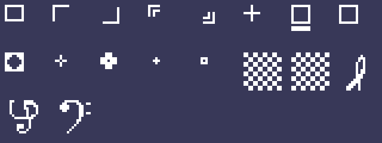

# Los sprites

*Game Land* es un programa para hacer juegos: los personajes los dibuja quien lo usa, con los editores (ver
[Los editores](LOS-EDITORES.html)). Los únicos dibujos de sprites que trae la ROM son los del propio programa, y los
pone `vram_prepara` (0x40D2) en la tabla de dibujos de los sprites (0x1800, el registro 6 = 3). Aquí `tools/hojas.py`
**ejecuta esa rutina** con el Z80 de `tools/bios.py` (las llamadas de la cinta, TAPOOF y STMOTR, y RDVDP no pintan
nada y se saltan) y pinta los dibujos de 16 × 16 que deja (el registro 1, 0xE2). Ninguna de estas imágenes es una
captura.

**Cotejado con openMSX** en las grabaciones de esta web: los dibujos desde el 0x90 hasta el final de la tabla que
deja aquí la rutina son **idénticos** a los del juego en 27.043 cuadros; en otros 232 los dibujos 0xD0-0xDC llevan el
personaje que se está editando, que escribe allí la ventana de muestra del editor (`personaje_muestra`, 0x61BA);
**0 distintos**.

## Los sprites del propio programa

Dieciocho dibujos, del 0x90 al 0xE8: recuadros, esquinas y cruces de varios tamaños para los cursores de los editores,
una trama a cuadros (dos veces) y tres signos de música, entre ellos las claves de sol y de fa del editor de música:

Los personajes que dibuja quien lo usa van desde 0x1800: cada uno, uno, dos o cuatro sprites de 16 × 16 en cuadro
(`objeto_dibuja`, 0x49AB: +0, +0x10, +0x1000 y +0x1010), con sus colores de cuatro en cuatro.
